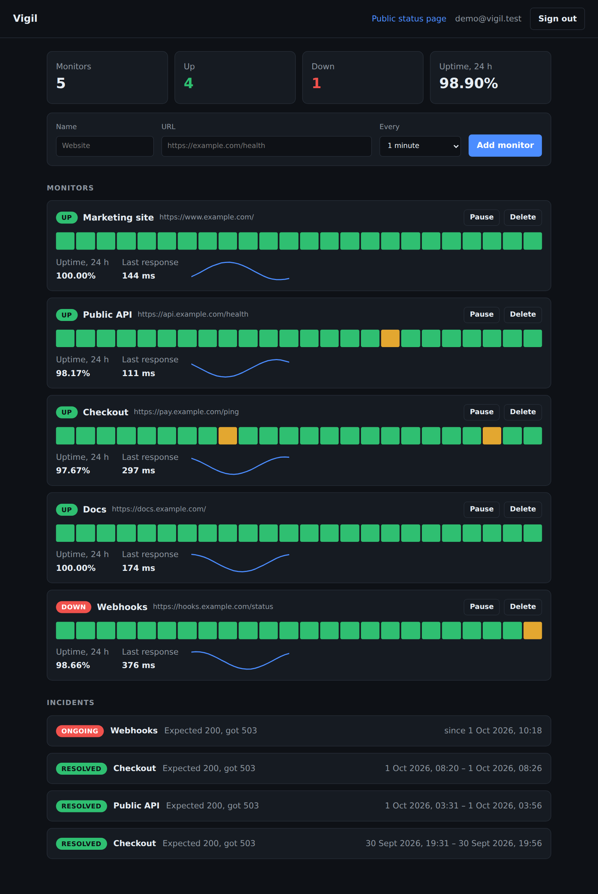
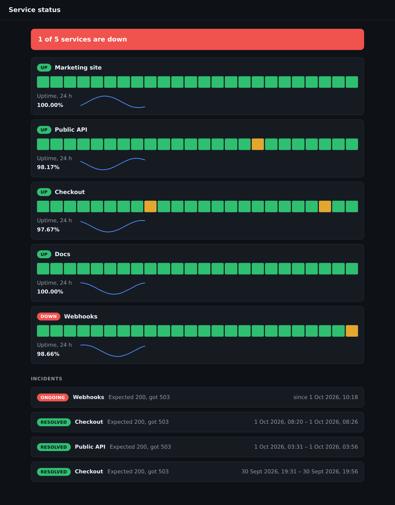

# Vigil

Self-hosted uptime monitoring with a public status page. Node.js, Express and
MongoDB on the server; a dependency-free front end served from the same
process.

Add the URLs you care about, Vigil checks them on a schedule, records every
result, opens an incident when a service stays down and closes it when the
service recovers. Each account gets a shareable status page that shows
availability without revealing what is being monitored.



The public status page for the same account:



Both screenshots are the running application after `npm run seed`.

## Run it

Requires Node.js 22 and MongoDB 7 (`docker compose up -d` starts one).

```sh
npm install
npm run seed
npm start
```

Open <http://localhost:3000> and sign in with `demo@vigil.test` /
`vigil demo password`, or create your own account. Configuration is read from
the environment; `.env.example` lists every variable with its default.

## How it works

```
src/
    app.js          wires middleware and routers; no logic of its own
    server.js       process entry: config, database, scheduler, shutdown
    auth/           password hashing, server-side sessions, account routes
    monitors/       validation, CRUD routes, 24 hour statistics
    checks/         target guard, HTTP probe, state transitions, scheduler
    status/         incident log and the public status endpoint
    http/           error model, request validation, security middleware
public/             dashboard and status page (ES modules, no build step)
```

**Scheduling.** A monitor is claimed with a single `findOneAndUpdate` that
moves `nextCheckAt` forward, so any number of Vigil processes can share one
database without checking a target twice.

**Flapping.** One failed check does not page anyone. A monitor goes down on
the second consecutive failure and comes back on the first success. That rule
is a pure function (`checks/outcome.js`) and is tested without a database.

**Storage.** Check results live in a MongoDB time-series collection that
expires after 30 days. Dashboard and status page statistics come from one
aggregation for all of an account's monitors.

## Security

A service that fetches URLs on behalf of its users is a request-forgery
target, so most of the care went here.

| Threat | Mitigation |
| --- | --- |
| SSRF to internal services or cloud metadata | Only `http`/`https`. Literal private, loopback, link-local and reserved addresses are rejected at creation. At check time the resolved addresses are validated inside the socket's `lookup`, so the address that was checked is the address that is connected to; DNS rebinding has no window. Redirects are never followed. |
| NoSQL operator injection | Every body, parameter and identifier passes a strict schema before it reaches a query. `{"email": {"$ne": null}}` is a 400. Unknown fields are rejected. |
| Access to other accounts' data | Every monitor query is scoped by owner. Foreign and malformed identifiers both answer 404. |
| Session theft | Opaque 256-bit tokens, stored as SHA-256 hashes, in an `HttpOnly`, `SameSite=Strict` cookie. Logout deletes the session on the server. |
| Password disclosure | scrypt with a per-password salt, constant-time comparison, and identical responses and timing for unknown emails and wrong passwords. |
| CSRF | `SameSite=Strict` cookies, and write requests must be `application/json`, which a cross-site form cannot send. |
| XSS | The front end builds DOM nodes and never assigns HTML. A content security policy allows scripts and styles from the same origin only. |
| Brute force and abuse | Rate limit on authentication routes, 10 kB body limit, a cap on monitors per account. |

Set `SECURE_COOKIES=true` and `TRUST_PROXY=1` when running behind TLS
termination. `ALLOW_PRIVATE_TARGETS=true` disables the SSRF guard for
monitoring services on your own network; leave it off on a shared instance.

## API

| Method | Path | Description |
| --- | --- | --- |
| `POST` | `/api/auth/register` | Create an account and sign in |
| `POST` | `/api/auth/login` | Sign in |
| `POST` | `/api/auth/logout` | Revoke the current session |
| `GET` | `/api/auth/me` | Current account |
| `GET` | `/api/monitors` | Monitors with 24 hour uptime and hourly buckets |
| `POST` | `/api/monitors` | Add a monitor |
| `PATCH` | `/api/monitors/:id` | Rename, retarget, change interval, pause or resume |
| `DELETE` | `/api/monitors/:id` | Remove a monitor and its history |
| `GET` | `/api/incidents` | Latest incidents for the account |
| `GET` | `/api/status/:slug` | Public status data, no authentication |

## Tests

```sh
npm run check
```

runs lint, the type check and three layers of tests:

- `test/unit` covers the pure parts: address classification, the up/down
  state machine, statistics, configuration and password hashing.
- `test/api` starts the real application against MongoDB and drives it over
  HTTP, including the scheduler probing a local target through an outage and
  recovery.
- `test/e2e` drives the dashboard in Chromium: registration, adding a
  monitor, an outage appearing on the public status page, markup in a
  monitor name staying text.

Tests need a MongoDB at `MONGODB_URL` (default
`mongodb://127.0.0.1:27017/vigil_test`). Set `CHROMIUM_PATH` to reuse an
installed browser instead of the one Playwright downloads.

## License

MIT
